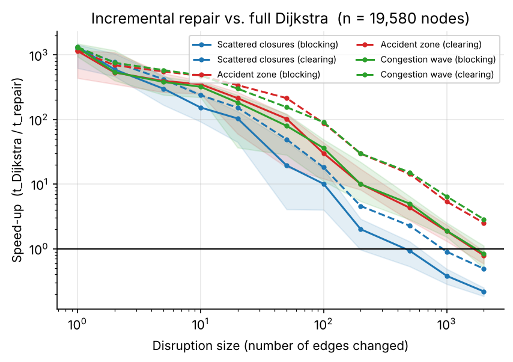
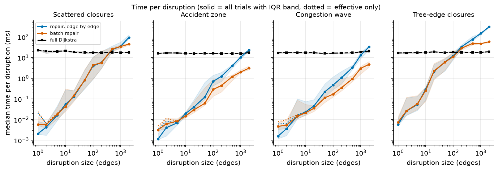
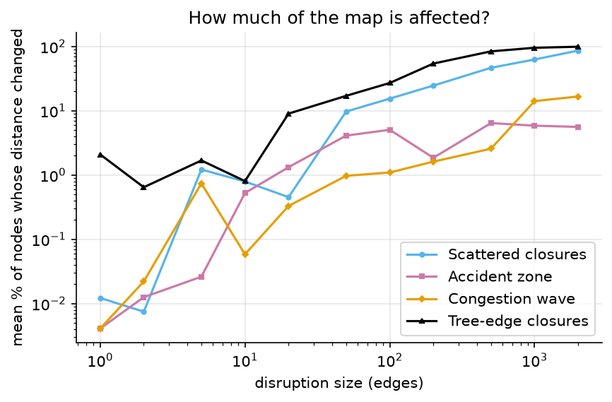
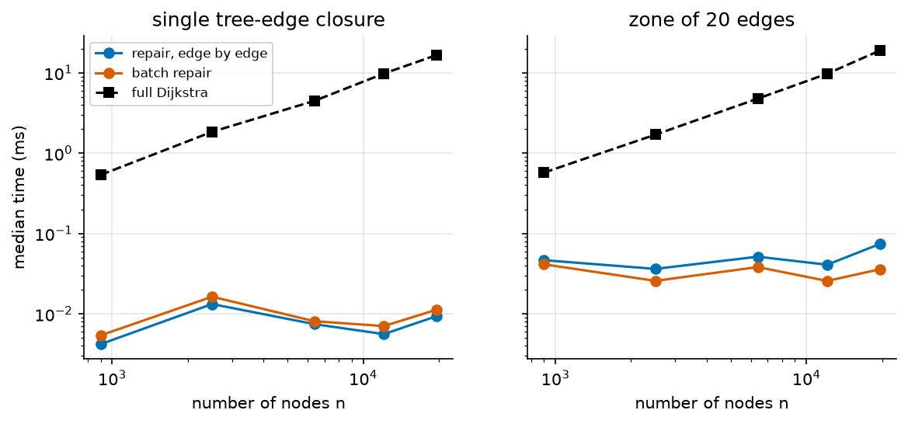
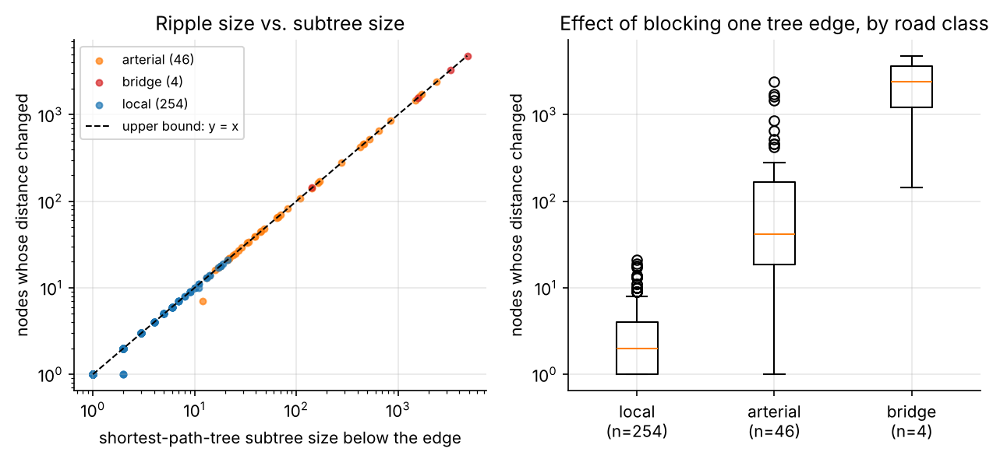
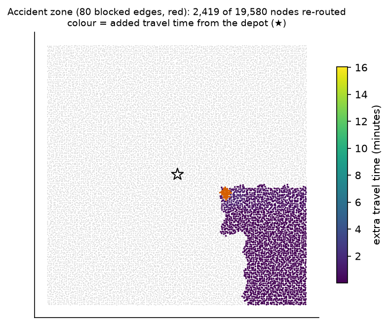
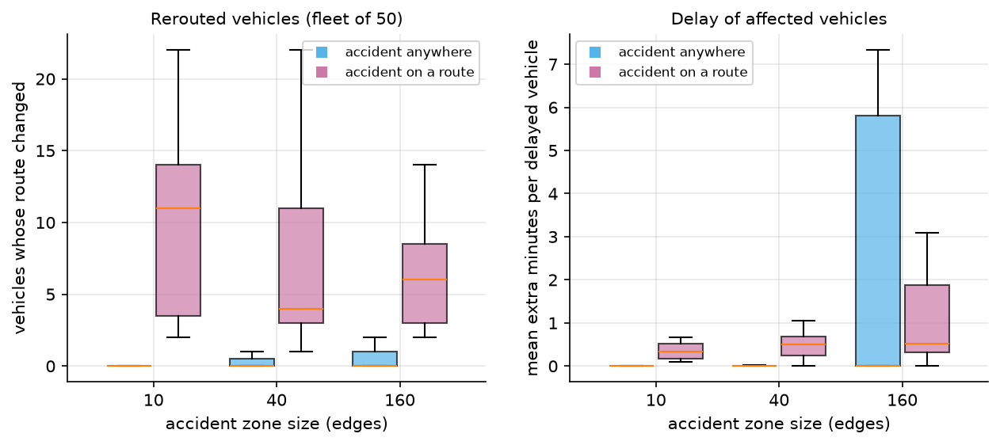
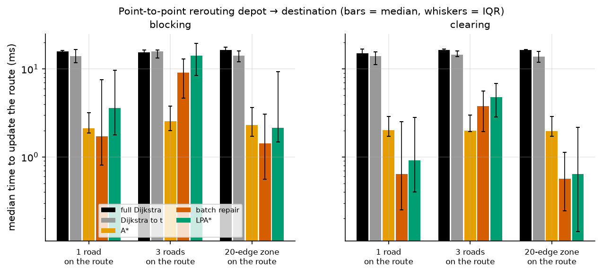
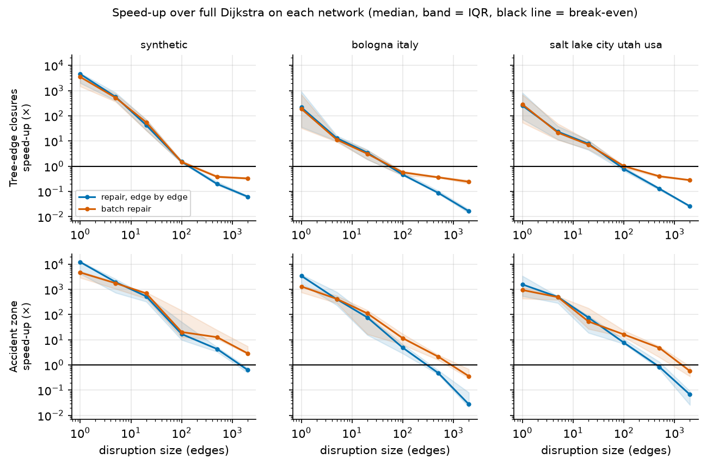

# Rush Hour Rerouting: results and information

*This file is generated by `report/build_summary.py` from `results/` (it is rewritten by every `python run_all.py`). Do not edit it by hand; edit the generator instead.*

Results produced by `python experiments/run_experiments.py --out results` at commit `ed9877f` in 410 s on Windows-10-10.0.26300-SP0 (Python 3.11.9). **136,601 repair-versus-Dijkstra checks, zero mismatches.**

## 1. What the project is about

A routing service keeps the shortest travel times from a depot to every intersection, together with the shortest-path tree that gives each vehicle its route. When an accident blocks roads or congestion slows them down, those routes must be updated. The textbook answer is to rerun **Dijkstra's algorithm** from scratch. The alternative studied here is to **repair** only the part of the tree that the change actually affects (Ramalingam–Reps style incremental shortest paths).

We compare, on identical graph states and with every result checked against a fresh Dijkstra run:

- **Full Dijkstra** recomputation (baseline).
- **Per-edge repair**: each changed road is repaired one at a time.
- **Batch repair** (our addition): all roads of one disruption are repaired in a single sweep (proof of correctness in the report, Theorem 2).
- For a single vehicle's route: **A\*** from scratch and **LPA\*** (Lifelong Planning A\*), an incremental goal-directed search.

Disruption models: *scattered closures* (random roads), *accident zone* (a connected cluster of roads), *congestion wave* (slow-down fading with distance from an epicentre), and *tree-edge closures* (only roads that carry at least one shortest path — the honest worst-case-relevant case). A closed road is modelled by **50× its travel time** in the main experiments; a separate experiment compares that with true deletion.

## 2. Road networks

| Network | Nodes | Directed edges | Avg. out-degree | Hop diameter (≥) | One-way edges |
|---|---|---|---|---|---|
| synthetic | 19,580 | 67,980 | 3.47 | 278 | 6% |
| bologna italy | 5,450 | 10,740 | 1.97 | 94 | 42% |
| salt lake city utah usa | 5,459 | 14,262 | 2.61 | 98 | 15% |

The main experiments use the synthetic city (n = 19,580): a perturbed street grid with arterial roads, one-way streets and a river crossed by four bridges. Real networks are OpenStreetMap drivable roads (© OpenStreetMap contributors, ODbL), cached in `data/`, restricted to the largest strongly connected component; travel times come from osmnx speed estimates.

## 3. Headline results

- **No-op trap.** 67–80% of random single-road closures change no distance at all (the road is on no shortest path), so repair exits immediately. Their median ‘speed-up’ of up to 14,018× is meaningless; we therefore report *effective* updates (something changed) separately.
- **One road that matters.** Blocking a single shortest-path-tree edge, per-edge repair was **2,757×** faster than full Dijkstra (0.006 ms vs 16.9 ms, medians).
- **Batch repair** is up to **7.7×** faster than per-edge repair at 2,000 changed edges (accident zone), because overlapping affected regions are re-solved only once.
- **Break-even.** Repair stops paying off once a disruption is large: see the table below. Beyond that size, recomputing from scratch is cheaper.

| Disruption | Break-even, per-edge repair (edges) | Break-even, batch repair (edges) | Per-edge, effective trials only |
|---|---|---|---|
| Scattered closures | ≈ 405 | ≈ 400 | ≈ 405 |
| Accident zone | ≈ 1,548 | > 2,000 (not reached) | ≈ 1,548 |
| Congestion wave | ≈ 1,480 | > 2,000 (not reached) | ≈ 1,480 |
| Tree-edge closures | ≈ 140 | ≈ 143 | ≈ 140 |

## 4. Figures

### Figure 1 – Speed-up versus disruption size

One panel per disruption model; blue = per-edge repair, red = batch repair; solid = all trials (band = inter-quartile range), dotted = effective trials only; above the black line repair is faster than recomputing.

| Edges changed | Scattered closures | Accident zone | Congestion wave | Tree-edge closures |
|---|---|---|---|---|
| 1 | 10,984× / 1,173× (67% no-op) | 14,018× / 4,576× (80% no-op) | 11,885× / 2,629× (67% no-op) | 2,757× / 2,757× (0% no-op) |
| 10 | 454× / 454× (0% no-op) | 928× / 928× (0% no-op) | 720× / 720× (0% no-op) | 64× / 64× (0% no-op) |
| 100 | 4.6× / 4.6× (0% no-op) | 22× / 22× (0% no-op) | 35× / 35× (0% no-op) | 1.6× / 1.6× (0% no-op) |
| 1,000 | 0.5× / 0.5× (0% no-op) | 1.6× / 1.6× (0% no-op) | 1.6× / 1.6× (0% no-op) | 0.1× / 0.1× (0% no-op) |

*Median speed-up of per-edge repair: all trials / effective trials (share of no-op trials).*

### Figure 2 – Time per disruption

Dijkstra's cost (black) is flat; repair cost grows with the number of changed roads.

### Figure 3 – How much of the map is affected

Mean percentage of intersections whose travel time changes. Repair work is proportional to this.

### Figure 4 – Scaling with network size

From 899 to 19,580 nodes, full Dijkstra became 31× slower while repairing a single tree-edge closure changed by 2.2×: repair cost depends on how much changes, not on the size of the map.

### Figure 5 – Which closures cause big ripples

304 single tree-edge closures. The number of changed distances never exceeded the size of the shortest-path-tree subtree below the closed road (the proof's bound) and was within 10% of it in 99% of cases. Median ripple by road class: arterial 41, bridge 2429, local 2.

### Figure 6 – Anatomy of one accident

The worst of 40 random 80-road accident zones: 2,419 of 19,580 intersections (12%) get a new travel time; colour = extra minutes from the depot.

### Figure 7 – Fleet rerouting

50 delivery vehicles; one accident zone per trial, placed anywhere or centred on a vehicle's route. Means over trials:

| Accident placed | Roads | Route used a closed road | Rerouted | Delayed | Median extra minutes | Stranded |
|---|---|---|---|---|---|---|
| anywhere | 10 | 0.2 | 0.2 | 0.2 | 0.4 | 0.0 |
| anywhere | 40 | 0.3 | 0.3 | 0.3 | 0.3 | 0.0 |
| anywhere | 160 | 0.7 | 0.7 | 0.7 | 7.3 | 0.0 |
| on a route | 10 | 12.3 | 12.3 | 12.3 | 0.3 | 0.0 |
| on a route | 40 | 7.5 | 7.5 | 7.5 | 0.5 | 0.0 |
| on a route | 160 | 6.5 | 6.5 | 6.5 | 0.5 | 0.0 |

### Figure 8 – One vehicle's route: LPA\* vs A\* vs repair

| Disruption | Phase | full Dijkstra | Dijkstra to t | A* | batch repair | LPA* |
|---|---|---|---|---|---|---|
| 1 road on the route | blocking | 15.79 ms | 14.02 ms | 2.13 ms | 1.71 ms | 3.59 ms |
| 1 road on the route | clearing | 15.16 ms | 14.04 ms | 2.01 ms | 0.64 ms | 0.92 ms |
| 20-edge zone on the route | blocking | 16.46 ms | 14.14 ms | 2.30 ms | 1.42 ms | 2.16 ms |
| 20-edge zone on the route | clearing | 16.43 ms | 13.80 ms | 1.98 ms | 0.57 ms | 0.64 ms |
| 3 roads on the route | blocking | 15.36 ms | 15.92 ms | 2.56 ms | 9.12 ms | 14.15 ms |
| 3 roads on the route | clearing | 16.40 ms | 14.54 ms | 2.00 ms | 3.81 ms | 4.80 ms |

LPA\* beat A\* from scratch in 1 of 3 blocking scenarios: when a road on the route is blocked, LPA\* must first invalidate and then rebuild the part of its search beyond the closure, which in pure Python costs about as much as searching again.

### Figure 9 – Synthetic versus real networks

| Network | Disruption | Speed-up, 1 road | Break-even per-edge | Break-even batch |
|---|---|---|---|---|
| synthetic | Tree-edge closures | 4,564× | ≈ 139 | ≈ 159 |
| synthetic | Accident zone | 3,674× | ≈ 1,439 | > 2,000 (not reached) |
| bologna italy | Tree-edge closures | 218× | ≈ 54 | ≈ 59 |
| bologna italy | Accident zone | 345× | ≈ 301 | ≈ 905 |
| salt lake city utah usa | Tree-edge closures | 255× | ≈ 85 | ≈ 102 |
| salt lake city utah usa | Accident zone | 543× | ≈ 442 | ≈ 1,397 |

### Closure model: 50× slower versus deleted

| Closure model | Disruption | Roads | Intersections changed | Stranded |
|---|---|---|---|---|
| delete | Accident zone | 1 | 10.1 | 0.0 |
| delete | Accident zone | 10 | 12.1 | 1.4 |
| delete | Accident zone | 100 | 402.7 | 21.6 |
| delete | Tree-edge closures | 1 | 365.7 | 0.0 |
| delete | Tree-edge closures | 10 | 1074.9 | 0.1 |
| delete | Tree-edge closures | 100 | 6415.4 | 2.1 |
| factor | Accident zone | 1 | 10.1 | 0.0 |
| factor | Accident zone | 10 | 11.7 | 0.0 |
| factor | Accident zone | 100 | 402.7 | 0.0 |
| factor | Tree-edge closures | 1 | 365.7 | 0.0 |
| factor | Tree-edge closures | 10 | 1074.9 | 0.0 |
| factor | Tree-edge closures | 100 | 6415.4 | 0.0 |

The same roads are closed under both models. The affected region is nearly identical; deletion additionally strands intersections that have no other way in.

### Implementation detail

Replacing per-call Python `set()` objects with reusable generation-stamped arrays changed the total time for 300 single closures from 66.8 ms to 62.0 ms (7% less).

## 5. Limitations

- Pure Python: absolute times and exact break-even sizes would move in C++/Rust; the comparisons between methods implemented in the same style are what the study supports.
- One depot (single source); random disruption models, not calibrated on real incident data.
- The straight-line A\*/LPA\* heuristic is calibrated to the fastest road and is therefore weak.
- See *Threats to validity* in the report for the full list.

## 6. Files

| File | Content |
|---|---|
| `report/Rush_Hour_Rerouting_Report.docx` | full report: algorithms, proofs, complexity, all results |
| `results/meta.json` | parameters, break-even points, git commit, command line |
| `results/summary_main.csv` | medians/IQRs per disruption model, size, method (all vs effective) |
| `results/raw_*.csv` | one row per trial for every experiment |
| `results/graph_stats.csv`, `summary_crossgraph.csv` | real-network comparison |
| `results/fig1…fig9*.png` | the figures above |
| `data/*.graphml` | cached OpenStreetMap networks (© OpenStreetMap contributors, ODbL) |

Reproduce everything with `pip install -r requirements.txt` and `python run_all.py` (the quick smoke test is `python run_all.py --quick`).
